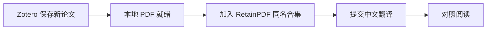

<div align="center">

# Zotero → RetainPDF

**一个自用的 Zotero 小插件，让保存论文、归类和翻译连起来。**

[下载插件](https://github.com/haoning-Chen226/zotero-retainpdf/releases/latest) · [下载 RetainPDF](https://github.com/wxyhgk/retain-pdf/releases/latest) · [下载 Zotero](https://www.zotero.org/download/) · [反馈问题](https://github.com/haoning-Chen226/zotero-retainpdf/issues)

</div>

在 Zotero 保存新论文后，插件会等待本地 PDF 就绪，按 Zotero 的分类路径放入 RetainPDF 对应合集，再提交中文全文翻译。主要用于我自己的文献阅读流程，按实际需要维护。



## 下载

| 需要安装的内容 | 下载入口 |
| --- | --- |
| **本插件** | [GitHub Releases，下载 `.xpi`](https://github.com/haoning-Chen226/zotero-retainpdf/releases/latest) |
| **RetainPDF 桌面版** | [官方最新版本](https://github.com/wxyhgk/retain-pdf/releases/latest) · [全部历史版本](https://github.com/wxyhgk/retain-pdf/releases) |
| **Zotero** | [官方下载](https://www.zotero.org/download/) |

本插件使用 RetainPDF 的本地翻译服务，需要先安装并配置 RetainPDF。

<details>
<summary><strong>RetainPDF 4.2.6 下载直达</strong></summary>

以下为官方 v4.2.6 安装包，本插件的实测使用了这一版本的 macOS 桌面端。

| 系统 | 官方安装包 |
| --- | --- |
| macOS | [RetainPDF-Mac-4.2.6.dmg](https://github.com/wxyhgk/retain-pdf/releases/download/v4.2.6/RetainPDF-Mac-4.2.6.dmg) |
| Windows | [RetainPDF-Windows-4.2.6-Setup.exe](https://github.com/wxyhgk/retain-pdf/releases/download/v4.2.6/RetainPDF-Windows-4.2.6-Setup.exe) |
| Linux | [RetainPDF-Linux-4.2.6.deb](https://github.com/wxyhgk/retain-pdf/releases/download/v4.2.6/RetainPDF-Linux-4.2.6.deb) |

上表是 RetainPDF 的系统安装包。插件在其他系统上的兼容性仍需验证。

</details>

## 安装与使用

1. **配置 RetainPDF**  
   安装并打开 RetainPDF，填好 OCR 和翻译模型所需的凭据，确认它能正常翻译 PDF。
2. **安装 Zotero 插件**  
   从上方入口下载 `.xpi`，在 Zotero 的「工具 → 插件」中打开齿轮菜单，选择「Install Plugin From File…」，然后选中安装包。
3. **保存一篇新论文**  
   在 Zotero「我的文库」中保存论文，放入所需分类，等待主 PDF 下载完成。
4. **到 RetainPDF 阅读**  
   打开对应合集或任务中心，查看翻译进度。完成后即可对照阅读。书库显示旧列表时，用「View → Reload」刷新。

## 归类规则

例如 Zotero 中的论文位于 `Motion / Egomotion`，插件会沿这条路径查找 RetainPDF 合集。

- 同一层级有同名合集时直接复用，缺少时创建。
- 论文属于多个分类时，会加入对应的多个合集。
- 未分类论文会放入「未分类」合集。
- 归类完成后才提交翻译，通过 PDF 内容哈希和任务记录避免重复提交。

分类使用首次导入时的路径。之后移动或重命名 Zotero 分类时，可在 RetainPDF 中对应调整。RetainPDF 4.2.6 保存合集父子关系，桌面的合集列表会平铺展示。

## 实测环境与范围

| 组件 | 实测环境 |
| --- | --- |
| 系统 | macOS |
| Zotero | 10.0.6，插件声明兼容 `10.0.*` |
| RetainPDF | 4.2.6 桌面版 |
| 本地网关 | `http://127.0.0.1:40001` |

已验证真实论文的导入、归类和译文生成。其他系统、Zotero 版本及 RetainPDF 版本需分别验证。

首次启用会记录处理起点，之后「我的文库」中新保存的论文及其本地主 PDF 进入队列。每篇论文选择一个主 PDF，并跳过可识别的译文附件。旧论文补附件、网页 PDF 链接和群组文库不在当前自动处理范围。

## 进度与重试

- 插件完成提交表示 RetainPDF 已接收任务，最终进度以 RetainPDF 任务中心为准。
- 连接失败或 Zotero 重启后会继续处理，连接重试间隔最长约 30 分钟。
- RetainPDF 中已有的翻译任务会被复用，包含失败或取消的任务。需要重做时，在 RetainPDF 任务中心手动重试。
- 模型和凭据取自 RetainPDF 当前桌面配置，插件使用中文、SCI 翻译规则和自动渲染等默认参数。

## 数据与费用

插件通过本机回环地址向 RetainPDF 发送 PDF、文件名、论文标题和分类。后续 OCR 与翻译使用你在 RetainPDF 中配置的服务，内容处理和费用遵循这些服务的设置。

队列文件保存在 Zotero 数据目录，名为 `retainpdf-bridge-state.json`，包含论文条目标识、标题、分类、本地 PDF 路径和任务标识。OCR 与模型凭据在请求时读取，队列文件不保存这些凭据。

提交问题时，请附上系统、Zotero 和 RetainPDF 版本、复现步骤及错误信息。分享日志前先去掉密钥和个人路径。[提交 Issue](https://github.com/haoning-Chen226/zotero-retainpdf/issues)

## 从源码构建

需要 Python 3，测试需要 Node.js 22 或更新版本。

```bash
node --test tests/retain.test.js
python3 scripts/build.py --repo haoning-Chen226/zotero-retainpdf
```

构建会生成 `.xpi` 和 `updates.json`。版本发布步骤见 [PUBLISH.md](PUBLISH.md)。

---

感谢 [Zotero](https://www.zotero.org/) 与 [RetainPDF](https://github.com/wxyhgk/retain-pdf) 提供文献管理与翻译能力。
